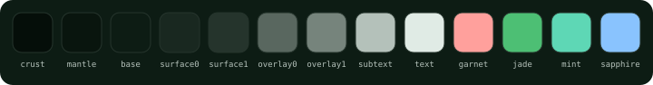
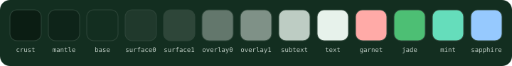
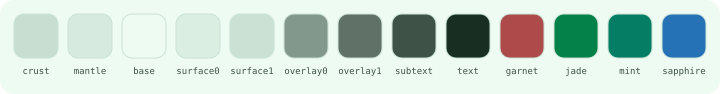
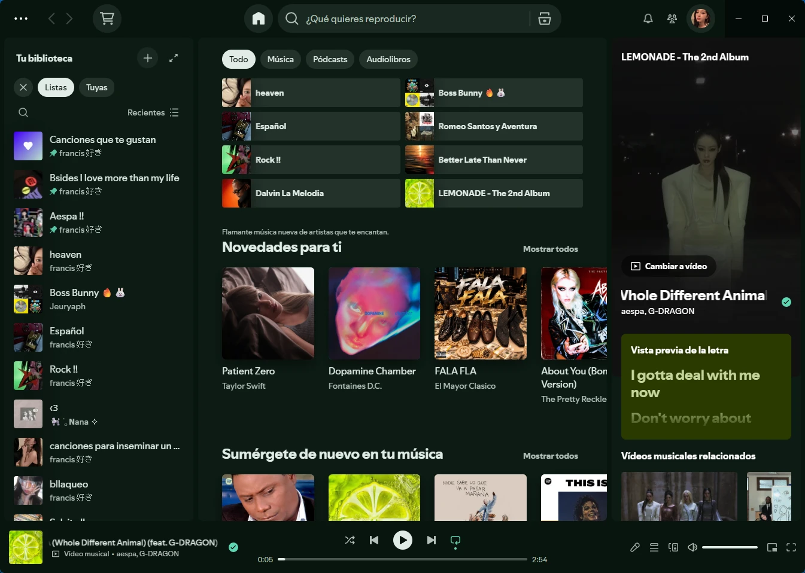
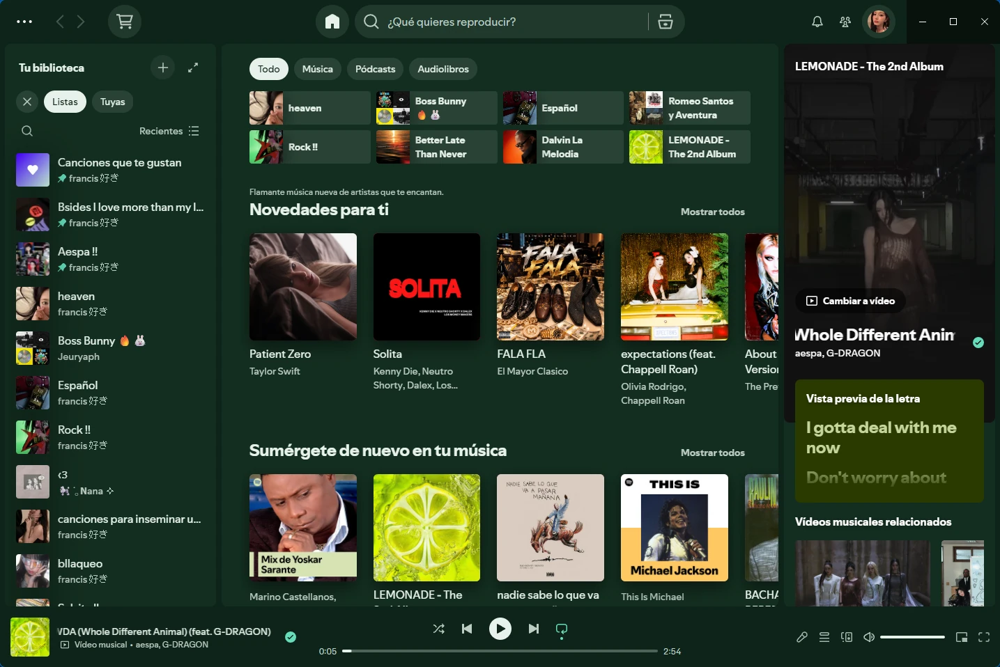
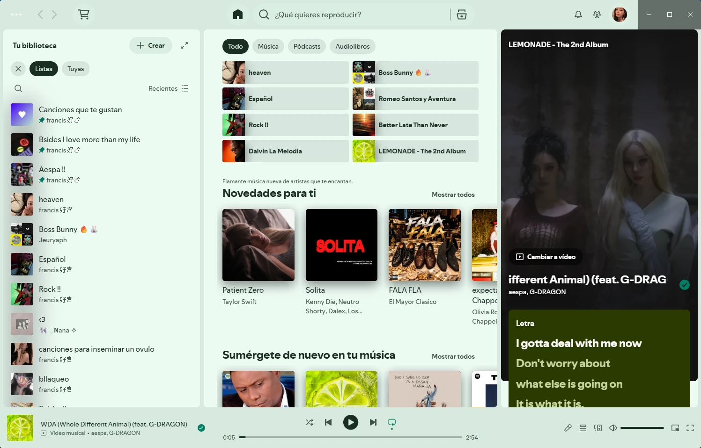

<div align="center">


# Nephrite for Spotify

**English** · [Español](README.es.md)

A calm, jade-inspired theme for [Spotify](https://www.spotify.com), in three flavors. Built for [Spicetify](https://spicetify.app).

[](LICENSE)
[](https://github.com/Nephrite-theme/palette)

</div>

## Flavors

| Flavor | Colors used | For |
| --- | --- | --- |
| **Forest** |  | Deep and dark, for late nights |
| **Jade** |  | Dark with more green, for long days |
| **Mint** |  | Light and airy, for daylight |

## Previews







## Install

Spotify doesn't support themes on its own, so Nephrite uses [Spicetify](https://spicetify.app), a community tool that customizes the desktop app. [Install Spicetify](https://spicetify.app/docs/getting-started) first.

### From the Spicetify Marketplace

Open the **Marketplace** tab in Spotify's sidebar, search for **Nephrite** and click **Install**. Then pick a flavor in the theme's color scheme menu.

The Marketplace can only install themes while it is the active theme. If it asks you to set `current_theme` to `marketplace` (for example, after a manual install), run:

```sh
spicetify config current_theme marketplace
spicetify apply
```

### Manually

1. Download this repository and copy the `Nephrite` folder into your Spicetify themes folder:
   - Windows: `%APPDATA%\spicetify\Themes\`
   - macOS and Linux: `~/.config/spicetify/Themes/`
2. Apply it, replacing `Forest` with `Jade` or `Mint` for another flavor:

   ```sh
   spicetify config current_theme Nephrite color_scheme Forest
   spicetify apply
   ```

To switch flavors later, run the same commands with another color scheme. To remove the theme, run `spicetify restore`.

Spotify updates can undo Spicetify's changes. If the theme disappears after an update, run `spicetify backup apply`.

## Colors

Every color comes from the [Nephrite palette](https://github.com/Nephrite-theme/palette), mapped to Spotify by role:

| Spotify surface | Palette color |
| --- | --- |
| Main view | `base` |
| Library sidebar and player bar | `mantle` |
| Cards, hovered rows, menus | `surface0`, `surface1` when raised |
| Main text | `text` |
| Secondary text | `subtext` |
| Play button, progress bar, liked songs | `jade`, `mint` when pressed |
| Disabled controls | `overlay0` |
| Notifications and errors | `sapphire` and `garnet` |

## Development

`Nephrite/color.ini` and the swatches in `assets/` are generated, so don't edit them by hand. To pick up palette changes:

```sh
node scripts/sync-palette.mjs   # download the latest palette.json
node scripts/build.mjs          # regenerate color.ini
```

`Nephrite/user.css` holds the few rules that color variables can't reach: it keeps the home page on the flavor's base color and keeps text light over Canvas videos. It only uses the stable class names Spicetify maps, never Spotify's hashed ones, which change with every update. Node 18 or newer, no dependencies.

## Contributing

Found a color that clashes, or a part of Spotify the theme misses? [Open an issue](https://github.com/Nephrite-theme/spotify/issues/new/choose) with a screenshot. For how Nephrite ports are built and reviewed, see the [contributing guide](https://github.com/Nephrite-theme/.github/blob/main/CONTRIBUTING.md).

## Thanks

Created and maintained by [@ingfranciscastillo](https://github.com/ingfranciscastillo). Contributors will be listed here as the community grows.

## More Nephrite

Nephrite is also available for Chrome, Firefox, VS Code and seven terminals. See every app at [getnephrite.dev/ports](https://getnephrite.dev/ports).
